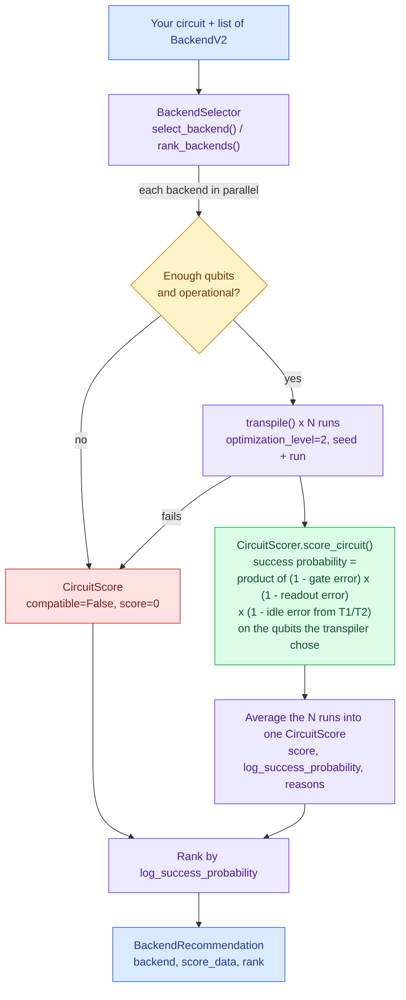

# Enhanced Quantum Backend Selector

[](https://github.com/sevetseh28/enhanced_quantum_backend_selector/actions/workflows/test.yml)
[](https://pypi.org/project/enhanced-quantum-backend-selector/)
[](https://www.python.org/downloads/)
[](https://opensource.org/licenses/Apache-2.0)
[](https://github.com/astral-sh/ruff)

Intelligent quantum backend selection for Qiskit circuits using transpilation-based error analysis.

## Usage

```bash
pip install enhanced-quantum-backend-selector
```

```python
from enhanced_quantum_backend_selector import BackendSelector
from qiskit_ibm_runtime import SamplerV2

selector = BackendSelector(backends)        # any list of Qiskit BackendV2
best = selector.select_backend(circuit)     # transpile, score and pick the best

print(best.backend.name)                    # e.g. "ibm_kingston"
sampler = SamplerV2(mode=best.backend)      # run on it as usual

ranking = selector.rank_backends(circuit)   # every backend, best first
```

See the [Quick Start](#quick-start) for a complete example with IBM Quantum backends.

## Overview

Quantum computing users typically rely on simplistic backend selection methods like `least_busy()`, which only considers queue depth. This library provides intelligent backend selection by **transpiling your circuit to each backend** and calculating the actual expected error rates:

- **Transpilation-Based**: Circuits are transpiled to each backend's native gate set
- **Real Error Calculation**: Combines the actual gate and readout error rates of the specific qubits the transpiler chose, plus decoherence while they sit idle, into an estimated success probability
- **Multiple Runs**: Averages over multiple transpilation runs for stability (default: 3, configurable)
- **Direct Quality Metric**: Score = estimated success probability, between 0 and 1 (higher is better)
- **Compatibility Checks**: Backends with too few qubits, that are offline, or that fail to transpile are flagged and ranked last

## How It Works



`BackendSelector` is the entry point. For each backend it transpiles your circuit and
hands the result to `CircuitScorer`, which looks up the calibrated error of every gate
and readout on the qubits that were actually used, plus the decoherence each qubit
suffers while it waits for others. Each backend ends up with a
`CircuitScore`, and the ranked list is returned as `BackendRecommendation` objects.

## Installation

```bash
pip install enhanced-quantum-backend-selector
```

Or with Poetry:

```bash
poetry add enhanced-quantum-backend-selector
```

## Quick Start

```python
from enhanced_quantum_backend_selector import BackendSelector
from qiskit import QuantumCircuit
from qiskit_ibm_runtime import QiskitRuntimeService

# Get available backends
service = QiskitRuntimeService()
backends = service.backends()

# Create your circuit
qc = QuantumCircuit(3)
qc.h(0)
qc.cx(0, 1)
qc.cx(1, 2)
qc.measure_all()

# Select the best backend
selector = BackendSelector(backends)
best = selector.select_backend(qc)

print(f"Recommended: {best.backend.name}")
print(f"Score: {best.score_data.score:.3f}")  # Success probability, 0 to 1
print(f"Expected error: {1 - best.score_data.score:.2%}")  # As percentage
print(f"Reasons: {', '.join(best.score_data.reasons)}")
```

## Features

- ✅ **Transpilation-Based Scoring**: Calculates actual error rates for your specific circuit
- ✅ **Fractional Gates Support**: Pass standard and fractional-gate versions of a backend to compare them for chemistry circuits
- ✅ **Reproducible Rankings**: Pass `seed=` to get the same ranking every run
- ✅ **Provider Agnostic**: Works with any Qiskit BackendV2 provider (IBM, Aer, etc.)
- ✅ **Multiple Run Averaging**: Configurable transpilation runs (default: 3) for stable scoring
- ✅ **Parallel Processing**: Scores multiple backends concurrently (up to 10 workers)
- ✅ **Comprehensive Type Hints**: Full mypy strict mode compliance
- ✅ **Extensive Documentation**: Detailed docstrings with examples

## Rank All Backends

```python
# Get full ranking
rankings = selector.rank_backends(qc, top_n=5)

for rec in rankings:
    error_pct = (1 - rec.score_data.score) * 100
    print(f"#{rec.rank}. {rec.backend.name}: {rec.score_data.score:.4f} ({error_pct:.2f}% error)")
```

## Limitations

Scores are estimates from reported calibration data. They assume independent errors,
and leave out crosstalk, dynamical decoupling, and queue time. See
[Limitations](https://sevetseh28.github.io/enhanced_quantum_backend_selector/user-guide/#limitations)
for the full list and expected run times.

## Development

See [CONTRIBUTING.md](https://github.com/sevetseh28/enhanced_quantum_backend_selector/blob/main/enhanced-quantum-backend-selector/CONTRIBUTING.md) for development setup and guidelines.

```bash
# Clone repository
git clone https://github.com/sevetseh28/enhanced_quantum_backend_selector.git
cd enhanced-quantum-backend-selector/enhanced-quantum-backend-selector

# Install with development dependencies
poetry install --with dev,docs

# Run tests
poetry run pytest

# Run type checking
poetry run mypy src/

# Format code
poetry run ruff format .
```

## Benchmarking

The library includes a comprehensive benchmarking suite with real-world quantum circuits to evaluate backend selector performance using mock backends that simulate real IBM Quantum processors (Heron R1, Heron R2, Heron R3, and Nighthawk):

```bash
# Run full benchmark suite
poetry run python benchmarks/run_benchmarks.py

# Run benchmark tests
poetry run pytest tests/test_benchmarks.py -v
```

**Benchmark Circuits:**
- **GHZ**: Multi-qubit entanglement testing
- **Bernstein-Vazirani**: Parallel operations and phase kickback
- **Mirror_5k**: Device benchmarking (circuit inversion)
- **LUCJ Ansatz**: Quantum chemistry applications
- **QAOA**: Combinatorial optimization

**Mock Backends** (based on real IBM processors):
- **IBM Heron R1**: 133 qubits, heavy-hex topology, 1,800 gate capacity
- **IBM Heron R2**: 156 qubits, heavy-hex topology, 5,000 gate capacity
- **IBM Heron R3**: 156 qubits, heavy-hex topology, improved error rates
- **IBM Nighthawk**: 120 qubits, square lattice, superior connectivity

See [Benchmarking Guide](https://sevetseh28.github.io/enhanced_quantum_backend_selector/benchmarking/) for detailed methodology, metrics, and references.

## Documentation

- [User Guide](https://sevetseh28.github.io/enhanced_quantum_backend_selector/user-guide/)
- [API Reference](https://sevetseh28.github.io/enhanced_quantum_backend_selector/api-reference/)
- [Benchmarking Guide](https://sevetseh28.github.io/enhanced_quantum_backend_selector/benchmarking/)
- [Examples](https://github.com/sevetseh28/enhanced_quantum_backend_selector/tree/main/enhanced-quantum-backend-selector/examples)
- [Contributing Guidelines](https://github.com/sevetseh28/enhanced_quantum_backend_selector/blob/main/enhanced-quantum-backend-selector/CONTRIBUTING.md)
- [Release Process](https://github.com/sevetseh28/enhanced_quantum_backend_selector/blob/main/enhanced-quantum-backend-selector/RELEASE.md)
- [Changelog](https://github.com/sevetseh28/enhanced_quantum_backend_selector/blob/main/enhanced-quantum-backend-selector/CHANGELOG.md)

## License

This project is licensed under the Apache License 2.0 - see the [LICENSE](https://github.com/sevetseh28/enhanced_quantum_backend_selector/blob/main/enhanced-quantum-backend-selector/LICENSE) file for details.

## Citation

If you use this library in your research, please cite:

```bibtex
@software{enhanced_quantum_backend_selector,
  title = {Enhanced Quantum Backend Selector},
  author = {Esteves, Hernan},
  year = {2025},
  url = {https://github.com/sevetseh28/enhanced_quantum_backend_selector}
}
```

## Contributing

Contributions are welcome! Please read [CONTRIBUTING.md](https://github.com/sevetseh28/enhanced_quantum_backend_selector/blob/main/enhanced-quantum-backend-selector/CONTRIBUTING.md) for details on our code of conduct and the process for submitting pull requests.

## Acknowledgements

Developed as part of the [Qiskit Advocate Mentorship Program (QAMP)](https://github.com/qiskit-advocate/qamp-2025) 2025, mentored by Junye Huang ([@HuangJunye](https://github.com/HuangJunye)).
